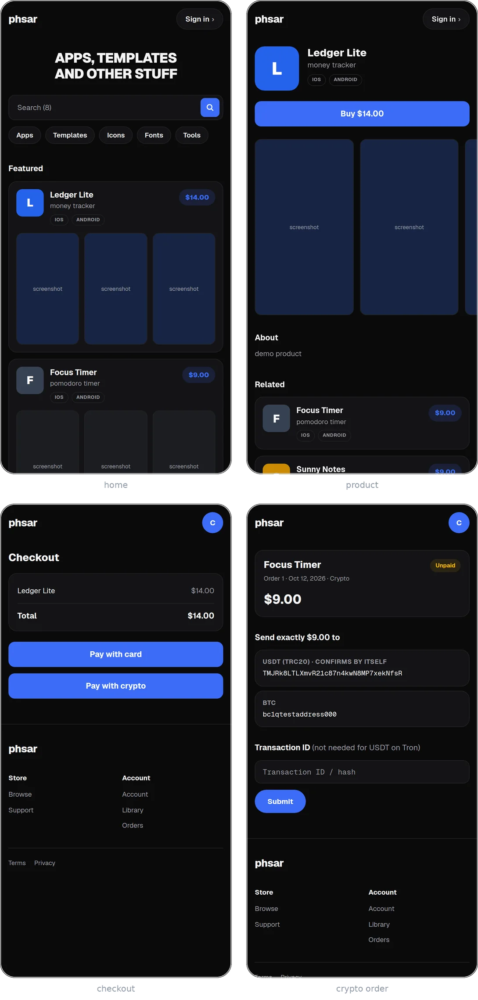
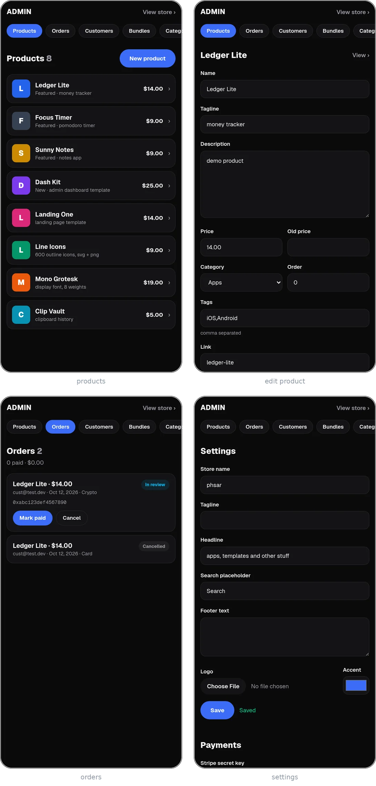

# phsar

self hosted store for selling apps and other digital stuff. think app store page, but its your own site and you run it

demo: https://app.justsal.xyz

```
pnpm install
pnpm dev
```

makes a sqlite db in `data/` on first run and puts some fake products in so its not empty

first account you sign up with is the owner, after that go to `/admin` and change whatever

payments are off until you put a stripe key or a wallet address in admin > settings. usdt sent to a tron (trc20) wallet gets matched to the order and confirms on its own, any other coin you confirm by hand under orders. google login is the same deal, paste the client id + secret in settings

heads up: the card flow and google login havent been run against real accounts yet

<picture>
  <source media="(min-width: 700px)" srcset="shots/store-row.webp">
  
</picture>

<picture>
  <source media="(min-width: 700px)" srcset="shots/admin-row.webp">
  
</picture>

## todo

- [x] storefront
- [x] product page
- [x] login, google login
- [x] admin (products, screenshots, bundles, categories, customers, pages, store settings)
- [x] checkout (stripe card, crypto)
- [x] orders, library, file downloads
- [x] terms / privacy / support pages
- [ ] emails (receipts, password reset)
- [ ] cart
- [ ] currencies other than usd
- [ ] reviews
